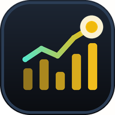

# Trader BotView

<p align="center">
  
</p>

<p align="center"><b>Une grille Futures, douze valeurs, un appui pour copier.</b></p>

<p align="center">
  <a href="https://moonspiid.github.io/trader-botview/"><b>Ouvrir l'application</b></a>
</p>

<p align="center"><sub><a href="README.md">English</a> · Français</sub></p>

Un bot de grille Futures ne se règle pas au feeling. Il faut une borne basse, une borne haute, un nombre de niveaux, une marge par grille, un levier, un stop : douze nombres qui doivent rester cohérents entre eux. Un seul faux pas et le bot ouvre trois ordres au lieu de vingt, ou se fait liquider sur une mèche.

BotView calcule ces douze valeurs à partir du marché réel, les affiche sur un seul écran de téléphone, et met un bouton **Copier** sur chacune.

## Sommaire

- [Ce que fait l'outil](#ce-que-fait-loutil)
- [Les douze valeurs](#les-douze-valeurs)
- [Démarrage rapide](#démarrage-rapide)
- [Nombre de grilles](#nombre-de-grilles)
- [Comment la grille est calculée](#comment-la-grille-est-calculée)
- [Mode Auto IA](#mode-auto-ia)
- [Langues](#langues)
- [Volet actualités](#volet-actualités)
- [Installer sur mobile](#installer-sur-mobile)
- [Bon à savoir](#bon-à-savoir)
- [Soutenir le projet](#soutenir-le-projet)
- [Licence](#licence)

## Ce que fait l'outil

- **Un seul écran, pas de défilement** — en-tête, mode, paire, quatre indicateurs, puis les douze cases de la grille. Tout tient dans un téléphone, même en 390 × 844. Seuls le volet d'actualités et son contenu défilent.
- **Aucune liste de paires** — en mode manuel vous tapez le symbole (`BTC`, `BTCUSDT`, `ethusdt`), il est normalisé et vérifié contre les filtres Binance. En mode auto, c'est le scan qui choisit la paire.
- **Libellés bilingues** — chaque case affiche le terme local suivi du terme anglais en gris (`Paire Pair`, `Marge/grille Margin/grid`, `Borne basse Lower bound`). Un trader qui colle ces valeurs dans une interface Binance en anglais retrouve immédiatement le bon champ, même si son interface est en français.
- **Douze valeurs copiables** — chaque case est un bouton : un appui copie la valeur brute, prête à coller dans Binance, et la case passe au vert avec « Copié ». Le nombre de grilles reste modifiable : saisie directe, boutons − / +, ou retour au calcul automatique.
- **Calcul Futures** — mode de marge isolé, levier, marge par grille, quantité par grille arrondie au `stepSize`, bornes arrondies au `tickSize`, TP et SL, largeur de plage et profit net par grille après frais.
- **Langue choisie toute seule** — au premier lancement, la page déduit la langue du fuseau horaire (français en Algérie, au Maroc, en Tunisie, au Sénégal, en France, au Québec) puis de la langue du navigateur, avec l'anglais en repli. Le bouton globe de l'en-tête passe à la langue suivante et mémorise le choix.
- **Volet d'actualités** — un panneau coulissant liste les annonces Binance (listings, radiations, maintenance, API, airdrops) avec leur date relative, sans clé d'API.
- **Installable** — bouton d'installation, `manifest`, service worker et cache : l'app s'ouvre en plein écran et démarre hors ligne.
- **Zéro dépendance** — une seule page HTML, pas de framework, pas de build, aucune clé, aucun ordre envoyé.

## Les douze valeurs

| Case | Ce que vous en faites |
| --- | --- |
| **Paire** | Le symbole du contrat, à coller dans le champ Binance |
| **Levier** | Le levier à régler avant de lancer la grille |
| **Marge** | Le mode de marge, `ISOLATED` par défaut |
| **Borne basse** | Limite inférieure de la grille |
| **Borne haute** | Limite supérieure de la grille |
| **Grilles** | Nombre de niveaux, modifiable de 2 à 150 |
| **Mode grille** | `ARITHMETIC` (pas fixe) ou `GEOMETRIC` (pas en pourcentage) |
| **Marge/grille** | Capital engagé par niveau |
| **Marge totale** | Capital total immobilisé par le bot |
| **Qté/grille** | Taille de chaque ordre, arrondie au `stepSize` |
| **TP** | Prise de profit, posée sur la borne haute |
| **SL** | Stop de sécurité sous la borne basse |

Les valeurs sont copiées sans séparateur de milliers et avec le point décimal (`55847.77`), c'est-à-dire exactement ce que Binance attend dans un champ numérique.

## Nombre de grilles

Le champ **Grilles** est un vrai champ de saisie, pas une valeur figée :

- **Automatique** (par défaut) : le nombre est déduit de la largeur de la plage et de la volatilité, entre 2 et 60 niveaux. La mention `auto` s'affiche dans la case.
- **Manuel** : tapez un nombre, ou appuyez sur **−** / **+**. La case passe en `auto` cliquable pour revenir au calcul.
- **Petit capital** : 2 ou 3 grilles suffisent pour démarrer. Avec 20 $ et un levier de 3, deux grilles passent le notionnel minimum ; le reste des valeurs (marge par grille, quantité, TP, SL) se recalcule à chaque frappe.
- **Capital en direct** : chaque chiffre tapé dans le champ Capital recalcule immédiatement la marge totale, la marge par grille et le nombre de grilles, sans attendre de quitter le champ. La marge totale vaut le capital moins une réserve de frais de 0,05 % du notionnel, et la marge par grille vaut ce montant ÷ grilles, sans arrondi caché.
- **Plafond forcé par le capital** : le nombre de grilles ne peut jamais dépasser ce que les fonds supportent. La limite vaut `notionnel ÷ (notionnel minimum par grille × 1,05)`, où le minimum par grille est le plus grand des deux seuils imposés par Binance : 5 $ de notionnel, et `quantité minimale × prix` — 0,001 BTC, soit 60 $ à 60 000 $.
- **Vérification de marge, dans l'ordre** : le capital passe d'abord en réserve de frais (0,05 % du notionnel, soit 1,50 $ sur 1 000 $ à 3×), puis l'outil cherche le plus petit nombre de grilles finançable. Si deux grilles ne tiennent pas au levier demandé, le levier est relevé juste ce qu'il faut, jusqu'au maximum de 10× — 30 $ sur BTCUSDT passent de 3× à 5×, 20 $ à 7×, 13 $ à 10×, et le champ Levier suit pour que la case copiable dise la vérité.
- **Validation finale bloquante** : avant affichage, neuf contrôles sont repassés sur le plan — au moins 2 grilles, levier entre 1 et 10, quantité positive et au-dessus du minimum du contrat, notionnel par grille au-dessus du minimum, quantité alignée sur le pas, marge totale dans le capital, réserve couverte. Un seul échec et rien n'est affiché.
- **Refus chiffré quand c'est physiquement impossible** : 12 $ sur BTCUSDT ne peuvent pas payer deux ordres de 60 $ à 10×, l'outil répond « fonds insuffisants : 13 $ minimum pour 2 grilles à 10× » au lieu d'afficher une quantité que Binance rejetterait.
- **Bornes resserrées quand le capital plafonne** : la plage suit la structure du marché, mais si le capital ne finance que 4 grilles sur une plage de 15 %, le pas grimperait à 3,9 %. La plage est alors ramenée à 4 × 1,8 fois le pas visé, centrée sur le prix, pour garder une grille exploitable.
- **Aucune quantité impossible** : la quantité est arrondie vers le bas au pas du contrat, puis vérifiée. Si elle passe sous la quantité minimale ou si son notionnel tombe sous 5 $, l'outil refuse de produire le plan et indique le capital nécessaire : « fonds insuffisants : 42 $ minimum pour 2 grilles à 3× ». Mieux vaut ce message qu'un ordre rejeté par Binance.
- **Données Futures bloquées** : si l'API Futures est inaccessible, la pastille d'état passe à l'ambre et un infobulle prévient que les filtres spot sont utilisés — les quantités minimales y sont plus permissives, à vérifier avant de lancer le bot.

Le nombre de grilles est conservé quand vous changez de paire, de capital ou d'unité de temps, jusqu'à ce que vous reveniez à `auto`.

## Démarrage rapide

1. Ouvrir **[l'application](https://moonspiid.github.io/trader-botview/)**.
2. **Manuel** : taper la paire, choisir l'unité de temps, régler le capital et le levier, puis **Analyser**.
   **Auto IA** : ne rien taper, appuyer sur **Scanner**. Le scan choisit la paire et remplit tout.
3. Lire la ligne du bas : profit net par grille et largeur de plage.
4. Copier les douze valeurs dans le formulaire de grille Futures de Binance.
5. Tester sur [testnet.binancefuture.com](https://testnet.binancefuture.com) avant tout argent réel.

## Comment la grille est calculée

- **Bornes** — le plus haut et le plus bas réellement touchés sur la fenêtre de la période : 42 bougies en 4 h (7 jours), 72 en 1 h (3 jours), 96 en 15 min (24 h), 30 en 1 j (1 mois). La borne basse est le plus bas de cette fenêtre, la borne haute son plus haut — les deux extrêmes que le trader voit sur son graphique, pas une bande théorique.
- **Marge autour du prix** — si le prix colle à un extrême (sortie de range, nouveau plus haut), la plage est étendue de 1,2 ATR de ce côté, au minimum 2 %, pour que le prix ne soit jamais collé au bord.
- **Cohérence avec le nombre de grilles** — la plage de structure est conservée tant que le pas reste entre 0,6 et 1,8 fois le pas visé. Au-delà, elle est resserrée autour du prix pour éviter des pas de 4 % avec trois grilles.
- **Nombre de grilles** — pas visé à 55 % de l'ATR, borné entre 0,5 % et 2,6 % du prix : le compte découle de la plage divisée par ce pas, puis entre 2 et 60 niveaux. Le compte est réduit tant que la marge par grille ne couvre pas le notionnel minimum du contrat.
- **Mode géométrique** — retenu quand la plage dépasse 12 % ou quand le prix dépasse 5 000, sinon arithmétique.
- **Levier et marge** — notionnel = capital investi × levier ; marge totale = capital − réserve de frais (0,05 % du notionnel) ; marge par grille = capital investi ÷ nombre de grilles ; quantité = notionnel / grilles / prix, arrondie vers le bas au `stepSize`.
- **Nombre de grilles selon le capital** — en automatique, le nombre de niveaux est plafonné par le capital : sur BTCUSDT à 3×, 100 $ donnent 4 grilles, 1 000 $ en donnent 11. Il remonte dès que le capital augmente, sans quitter le champ.
- **Stop** — 0,9 ATR sous la borne basse, borné entre 1,2 % et 6 %.
- **Profit net** — pas de grille moins 0,04 % de frais aller-retour (maker sur les deux côtés).

Les prix et quantités sont arrondis au `tickSize` et au `stepSize` du contrat, lus dans `exchangeInfo`. Si l'API Futures n'est pas joignable depuis votre pays, l'outil bascule sur les filtres du marché spot et le funding s'affiche « — ».

## Mode Auto IA

Le scanner récupère le ticker 24 h complet, garde les paires USDT dont le volume dépasse 15 M, écarte les tokens à effet de levier, puis analyse les 14 plus liquides sur l'unité de temps choisie. Chacune reçoit une note sur 100 :

| Critère | Poids |
| --- | --- |
| ADX bas (marché en range) | jusqu'à 34 |
| ATR entre 1 % et 4 % | jusqu'à 26 |
| Volume 24 h | jusqu'à 22 |
| Largeur de Bollinger | jusqu'à 8 |
| Variation 24 h extrême | jusqu'à −10 |

La meilleure note devient la configuration affichée. Le champ de paire passe en lecture seule : c'est le scan qui décide, pas vous.

## Langues

Il n'y a plus de liste de langues à choisir : la page se règle toute seule.

1. **Choix mémorisé** — si vous avez déjà changé de langue, c'est celui-là qui revient.
2. **Fuseau horaire** — `Africa/Algiers`, `Africa/Casablanca`, `Africa/Tunis`, `Africa/Dakar`, `Europe/Paris`, `Europe/Brussels`, `America/Montreal` et leurs voisins donnent le français. Un navigateur anglais en Algérie obtient donc du français, pas de l'anglais.
3. **Langue du navigateur** — si le fuseau n'est pas reconnu, `navigator.languages` tranche entre le français et l'anglais, et rien d'autre.
4. **Repli** — anglais.

Aucun appel réseau : la détection utilise le fuseau et le navigateur, pas une base d'adresses IP.

La langue locale et l'anglais fonctionnent ensemble : l'interface est dans la langue détectée, chaque libellé de case porte son équivalent anglais en gris, et toute chaîne absente d'une traduction retombe sur l'anglais plutôt que sur une clé technique.

L'interface ne bascule qu'entre deux langues : le français et l'anglais. Un fuseau espagnol, portugais, arabe ou japonais tombe sur l'anglais — aucune troisième langue n'est proposée. Le bouton **globe** de l'en-tête affiche la langue active (`FR` ou `EN`) et bascule de l'une à l'autre d'un appui, avec le nom de la langue en confirmation. Le choix est stocké et prioritaire sur la détection. Les nombres suivent la langue : `59 752,01` en français, `59,752.01` en anglais.

## Volet actualités

Le bouton ☰ ouvre un panneau coulissant alimenté par les annonces publiques de Binance (`bapi/composite/v1/public/cms/article/list`), sans clé ni proxy :

- listings et nouveaux contrats perpétuels,
- radiations de paires,
- maintenance de wallet et d'API,
- airdrops et actualités de la plateforme.

Chaque entrée porte une étiquette, une date relative (« il y a 9 heures ») et s'ouvre sur l'annonce d'origine. Un bouton ↻ recharge la liste. Un échec réseau affiche un bouton **Réessayer** au lieu d'un écran vide.

## Installer sur mobile

1. Ouvrir [la page](https://moonspiid.github.io/trader-botview/) dans le navigateur du téléphone.
2. Appuyer sur **⤓** en haut à droite.
3. **Android / ordinateur** : choisir *Installer l'application* dans le menu du navigateur. **iPhone / iPad** : **Partager**, puis **Sur l'écran d'accueil**.
4. L'icône BotView s'ouvre en plein écran, sans barre d'adresse, et redémarre depuis le cache si le réseau manque.

Le raccourci `?mode=auto` lance directement le scanner.

## Bon à savoir

- L'outil ne se connecte pas à votre compte, ne demande aucune clé et n'envoie aucun ordre. Il produit des nombres, vous les collez.
- Une grille ne protège pas d'une cassure : si le prix sort de la plage et touche le SL, le bot doit être coupé. Le levier élevé rapproche la liquidation, surtout avec une plage large.
- Le funding n'est affiché que si l'API Futures répond depuis votre pays ; les prix et les filtres viennent de `data-api.binance.vision`, qui reste accessible là où `api.binance.com` est bloqué.
- Les données publiques Binance peuvent être bloquées ou retardées ; un calcul de grille reste une estimation, pas une promesse de rendement.
- Un bot peut perdre tout le capital engagé. Les performances passées ne préjugent pas des performances futures.

## Soutenir le projet

L'outil est gratuit, sans compte, sans publicité et sans tracking, et il n'y a pas d'offre payante à la clé. S'il vous fait gagner du temps, un don paie les heures derrière et les prochaines fonctionnalités.

**Don en USDT →** une seule adresse crypto, pas de carte, pas de compte, pas de processeur de paiement entre les deux.

<p align="center">
  
  <br>
  <sub>À scanner avec n'importe quel wallet</sub>
</p>

```
0xA2700896E16BE762467D458F2B45260f8FAC9F3e
```

C'est une adresse EVM classique : **la même adresse fonctionne sur tous les réseaux EVM**. Envoyez l'USDT sur celui qui vous arrange :

| Réseau | Token |
| --- | --- |
| BNB Smart Chain (BEP20) | USDT |
| Ethereum (ERC20) | USDT |
| Polygon | USDT |
| Arbitrum One | USDT |
| Base | USDT |
| Optimism | USDT |

Deux règles : envoyez **uniquement de l'USDT** (un autre token envoyé à cette adresse ne peut pas être récupéré), et gardez un peu de la monnaie du réseau (BNB, ETH, POL) dans votre wallet pour payer les frais. Un réseau non-EVM comme Tron (TRC20) utilise un autre format d'adresse : rien de ce qui y est envoyé n'arrive ici.

## Licence

[MIT](LICENSE) © 2026 moonspiid — utilisez-le, modifiez-le, publiez-le.
