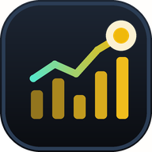

# Trader BotView

<p align="center">
  
</p>

<p align="center"><b>Une grille Futures, douze valeurs, un appui pour copier.</b></p>

<p align="center">
  <a href="https://moonspiid.github.io/trader-botview/"><b>Ouvrir l'application</b></a>
</p>

Un bot de grille Futures ne se règle pas au feeling. Il faut une borne basse, une borne haute, un nombre de niveaux, une marge par grille, un levier, un stop : douze nombres qui doivent rester cohérents entre eux. Un seul faux pas et le bot ouvre trois ordres au lieu de vingt, ou se fait liquider sur une mèche.

BotView calcule ces douze valeurs à partir du marché réel, les affiche sur un seul écran de téléphone, et met un bouton **Copier** sur chacune.

## Sommaire

- [Ce que fait l'outil](#ce-que-fait-loutil)
- [Les douze valeurs](#les-douze-valeurs)
- [Démarrage rapide](#démarrage-rapide)
- [Comment la grille est calculée](#comment-la-grille-est-calculée)
- [Mode Auto IA](#mode-auto-ia)
- [Langues](#langues)
- [Volet actualités](#volet-actualités)
- [Installer sur mobile](#installer-sur-mobile)
- [Bon à savoir](#bon-à-savoir)
- [Soutenir le projet](#soutenir-le-projet)
- [Licence](#licence)

## Ce que fait l'outil

- **Un seul écran, pas de défilement** — en-tête, mode, paire, quatre indicateurs, puis les douze cases de la grille. Tout tient dans un téléphone, même en 390 × 844. Seuls le volet d'actualités et son contenu défilent.
- **Aucune liste de paires** — en mode manuel vous tapez le symbole (`BTC`, `BTCUSDT`, `ethusdt`), il est normalisé et vérifié contre les filtres Binance. En mode auto, c'est le scan qui choisit la paire.
- **Douze valeurs copiables** — chaque case est un bouton : un appui copie la valeur brute, prête à coller dans Binance, et la case passe au vert avec « Copié ».
- **Calcul Futures** — mode de marge isolé, levier, marge par grille, quantité par grille arrondie au `stepSize`, bornes arrondies au `tickSize`, TP et SL, largeur de plage et profit net par grille après frais.
- **Trois langues** — français, anglais, espagnol. Le sélecteur de l'en-tête remplace tout le texte, y compris les nombres (séparateurs et formats locaux). Le choix est mémorisé.
- **Volet d'actualités** — un panneau coulissant liste les annonces Binance (listings, radiations, maintenance, API, airdrops) avec leur date relative, sans clé d'API.
- **Installable** — bouton d'installation, `manifest`, service worker et cache : l'app s'ouvre en plein écran et démarre hors ligne.
- **Zéro dépendance** — une seule page HTML, pas de framework, pas de build, aucune clé, aucun ordre envoyé.

## Les douze valeurs

| Case | Ce que vous en faites |
| --- | --- |
| **Paire** | Le symbole du contrat, à coller dans le champ Binance |
| **Levier** | Le levier à régler avant de lancer la grille |
| **Marge** | Le mode de marge, `ISOLATED` par défaut |
| **Borne basse** | Limite inférieure de la grille |
| **Borne haute** | Limite supérieure de la grille |
| **Grilles** | Nombre de niveaux entre les deux bornes |
| **Mode grille** | `ARITHMETIC` (pas fixe) ou `GEOMETRIC` (pas en pourcentage) |
| **Marge/grille** | Capital engagé par niveau |
| **Marge totale** | Capital total immobilisé par le bot |
| **Qté/grille** | Taille de chaque ordre, arrondie au `stepSize` |
| **TP** | Prise de profit, posée sur la borne haute |
| **SL** | Stop de sécurité sous la borne basse |

Les valeurs sont copiées sans séparateur de milliers et avec le point décimal (`55847.77`), c'est-à-dire exactement ce que Binance attend dans un champ numérique.

## Démarrage rapide

1. Ouvrir **[l'application](https://moonspiid.github.io/trader-botview/)**.
2. **Manuel** : taper la paire, choisir l'unité de temps, régler le capital et le levier, puis **Analyser**.
   **Auto IA** : ne rien taper, appuyer sur **Scanner**. Le scan choisit la paire et remplit tout.
3. Lire la ligne du bas : profit net par grille et largeur de plage.
4. Copier les douze valeurs dans le formulaire de grille Futures de Binance.
5. Tester sur [testnet.binancefuture.com](https://testnet.binancefuture.com) avant tout argent réel.

## Comment la grille est calculée

- **Largeur de plage** — dérivée de l'ATR 14 en pourcentage, multipliée par 6,2 puis bornée entre 7 % et 26 %. En tendance confirmée (ADX ≥ 25), la plage est resserrée de 15 %.
- **Centrage** — le milieu de la plage est décalé de quelques dixièmes de pourcent contre le biais du moment (EMA 20/50, histogramme MACD, RSI), pour laisser plus de place du côté où le prix respire.
- **Nombre de grilles** — pas visé à 55 % de l'ATR, borné entre 0,5 % et 2,6 % du prix, puis entre 8 et 60 niveaux. Le compte est réduit tant que la marge par grille ne couvre pas le notionnel minimum du contrat.
- **Mode géométrique** — retenu quand la plage dépasse 12 % ou quand le prix dépasse 5 000, sinon arithmétique.
- **Levier et marge** — notionnel = capital × levier ; marge par grille = capital / nombre de grilles ; quantité = notionnel / grilles / prix, arrondie vers le bas au `stepSize`.
- **Stop** — 0,9 ATR sous la borne basse, borné entre 1,2 % et 6 %.
- **Profit net** — pas de grille moins 0,04 % de frais aller-retour (maker sur les deux côtés).

Les prix et quantités sont arrondis au `tickSize` et au `stepSize` du contrat, lus dans `exchangeInfo`. Si l'API Futures n'est pas joignable depuis votre pays, l'outil bascule sur les filtres du marché spot et le funding s'affiche « — ».

## Mode Auto IA

Le scanner récupère le ticker 24 h complet, garde les paires USDT dont le volume dépasse 15 M, écarte les tokens à effet de levier, puis analyse les 14 plus liquides sur l'unité de temps choisie. Chacune reçoit une note sur 100 :

| Critère | Poids |
| --- | --- |
| ADX bas (marché en range) | jusqu'à 34 |
| ATR entre 1 % et 4 % | jusqu'à 26 |
| Volume 24 h | jusqu'à 22 |
| Largeur de Bollinger | jusqu'à 8 |
| Variation 24 h extrême | jusqu'à −10 |

La meilleure note devient la configuration affichée. Le champ de paire passe en lecture seule : c'est le scan qui décide, pas vous.

## Langues

Le sélecteur **FR / EN / ES** de l'en-tête traduit l'interface entière, placeholders compris, et reformate les nombres selon la langue (`59 752,01` en français, `59,752.01` en anglais). Le choix est stocké dans le navigateur et la page reprend la langue du système au premier lancement.

## Volet actualités

Le bouton ☰ ouvre un panneau coulissant alimenté par les annonces publiques de Binance (`bapi/composite/v1/public/cms/article/list`), sans clé ni proxy :

- listings et nouveaux contrats perpétuels,
- radiations de paires,
- maintenance de wallet et d'API,
- airdrops et actualités de la plateforme.

Chaque entrée porte une étiquette, une date relative (« il y a 9 heures ») et s'ouvre sur l'annonce d'origine. Un bouton ↻ recharge la liste. Un échec réseau affiche un bouton **Réessayer** au lieu d'un écran vide.

## Installer sur mobile

1. Ouvrir [la page](https://moonspiid.github.io/trader-botview/) dans le navigateur du téléphone.
2. Appuyer sur **⤓** en haut à droite.
3. **Android / ordinateur** : choisir *Installer l'application* dans le menu du navigateur. **iPhone / iPad** : **Partager**, puis **Sur l'écran d'accueil**.
4. L'icône BotView s'ouvre en plein écran, sans barre d'adresse, et redémarre depuis le cache si le réseau manque.

Le raccourci `?mode=auto` lance directement le scanner.

## Bon à savoir

- L'outil ne se connecte pas à votre compte, ne demande aucune clé et n'envoie aucun ordre. Il produit des nombres, vous les collez.
- Une grille ne protège pas d'une cassure : si le prix sort de la plage et touche le SL, le bot doit être coupé. Le levier élevé rapproche la liquidation, surtout avec une plage large.
- Le funding n'est affiché que si l'API Futures répond depuis votre pays ; les prix et les filtres viennent de `data-api.binance.vision`, qui reste accessible là où `api.binance.com` est bloqué.
- Les données publiques Binance peuvent être bloquées ou retardées ; un calcul de grille reste une estimation, pas une promesse de rendement.
- Un bot peut perdre tout le capital engagé. Les performances passées ne préjugent pas des performances futures.

## Soutenir le projet

L'outil est gratuit, sans compte, sans publicité et sans tracking, et il n'y a pas d'offre payante à la clé. S'il vous fait gagner du temps, un don paie les heures derrière et les prochaines fonctionnalités.

**Don en USDT →** une seule adresse crypto, pas de carte, pas de compte, pas de processeur de paiement entre les deux.

<p align="center">
  
  <br>
  <sub>À scanner avec n'importe quel wallet</sub>
</p>

```
0xA2700896E16BE762467D458F2B45260f8FAC9F3e
```

C'est une adresse EVM classique : **la même adresse fonctionne sur tous les réseaux EVM**. Envoyez l'USDT sur celui qui vous arrange :

| Réseau | Token |
| --- | --- |
| BNB Smart Chain (BEP20) | USDT |
| Ethereum (ERC20) | USDT |
| Polygon | USDT |
| Arbitrum One | USDT |
| Base | USDT |
| Optimism | USDT |

Deux règles : envoyez **uniquement de l'USDT** (un autre token envoyé à cette adresse ne peut pas être récupéré), et gardez un peu de la monnaie du réseau (BNB, ETH, POL) dans votre wallet pour payer les frais. Un réseau non-EVM comme Tron (TRC20) utilise un autre format d'adresse : rien de ce qui y est envoyé n'arrive ici.

## Licence

[MIT](LICENSE) © 2026 moonspiid — utilisez-le, modifiez-le, publiez-le.
